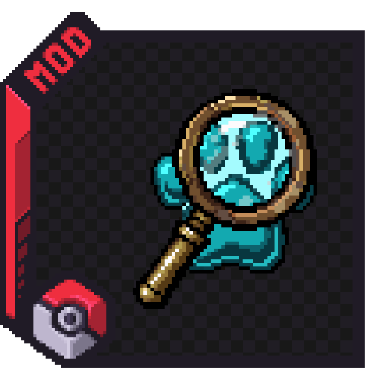
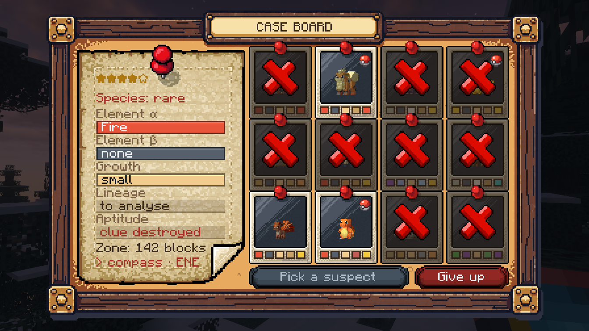
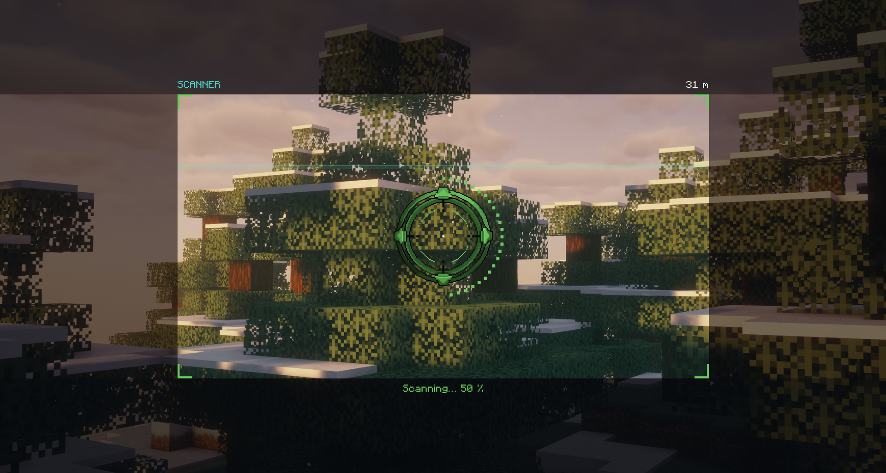

<p align="center"></p>

# Cobblemon: Field Investigations

A field investigation add-on for [Cobblemon](https://cobblemon.com/) (Fabric, Minecraft 1.21.1).

An unknown Pokémon has been reported nearby. Sample the traces it left behind, dig up buried clues, analyse their DNA in
mini-games, rule out suspects on your case board, then track the target by its cries, scan it from afar and catch it.
The cleaner your investigation, the better the Pokémon and the loot.

Everything fits in one item: the **Field Kit**. No workstation to carry around.





## How an investigation goes

1. **Pick a case.** Right-click with the Field Kit and check the reports: up to three leads are offered, each with its
   rarity, its distance and sometimes a special rule (see below). The one you pick gives you a trace zone 100–180 blocks
   away and a line-up of suspects taken from the species that really spawn in that biome.
2. **Sample the traces.** Five traces are hidden in the zone (elemental residue, strange deposit, footprint, abandoned
   nest, signs of a struggle). The kit's proximity radar leads you to them. Each kind of trace has its own sampling
   mini-game, and you need an empty vial for each. One trace may sit in a shallow cave (3 to 15 blocks deep, always
   reachable on foot from outside): the radar then shows its distance and height difference.
3. **Dig up buried clues.** Some clues (bone, eggshells, fang) are buried one or two blocks underground. The radar gives
   you the exact distance; dig carefully, then uncover the disturbed soil with a vanilla **brush**. Breaking that block
   destroys the clue.
4. **Analyse the samples.** Right-click a sample with the kit on you. Each of the five genetic markers (two elements,
   growth, lineage, aptitude) has two possible lab mini-games.
5. **Rule out suspects.** Every suspect shows its five markers. Compare them with your results and cross out the ones
   that do not fit yourself (right-click); nothing is done for you. With three markers analysed you can name your guess
   (left-click) and start the hunt.
6. **Track it.** Right-click with the kit to pick up the target's cry and get a bearing. Take several bearings from
   different spots: the kit map computes a fix.
7. **Scan it.** Once the target is in sight, hold right-click with the kit, crosshair on the Pokémon, for three seconds.
   Get too close before it is identified and it runs away.
8. **Catch it.** Approach without running, then battle or catch it.

## Stars, IVs and loot

Every investigation is rated from 1 to 5 stars. You start at 5:

| Event | Cost |
| --- | --- |
| Mini-game failure (damaged sample, lost dose, destroyed clue) | −½ star (the first one is free) |
| The target runs away | −1 star |
| Wrong guess | −2 stars |

- **Perfect IVs:** stars − 1 (none at 1 star, four at 5 stars). Shiny odds also rise with the stars.
- **Loot:** rolled from loot tables, one per star level, plus a small table for the rarity of the species and one for
  every fifth solved case.

## Special investigations

Some leads come with their own rule and their own reward. There is always at least one standard lead to pick instead.

Possible anywhere:

| Kind | Rule | Reward |
| --- | --- | --- |
| Nocturnal | Traces, cries and the target itself only show at night | Shiny odds ×2, special loot |
| Skittish | The target senses you from much farther away: scan it from a long distance | Double special loot |
| Exceptional | One more analysis result is required and the suspects all look alike | Hidden ability, special loot |
| Restless | The target moves twice as often during the hunt and its lair is farther away | Double special loot |

Tied to the biome of the trace zone (biome tags, with a fallback on the biome name for untagged modded biomes):

| Kind | Where | Rule | Extra loot |
| --- | --- | --- | --- |
| Aquatic | Oceans, rivers | Water species; traces on the bottom, target in the water | Water items |
| Dig site | Deserts, badlands, beaches | Every remain is buried | Fossils |
| Canopy | Forests, jungles, taigas | Traces on trunks and up in the treetops | Forest items |
| Highlands | Mountains, hills | Traces on rock faces, across a zone 1.5× wider | Rare stones |
| Frost | Snowy biomes | Frozen samples: one dose fewer each | Ice items |
| Mist | Swamps | Cries carry poorly: bearings 1.8× less precise | Swamp items |

Every special case rolls the `investigation/special` loot table, and also `investigation/kind_<kind>` (`nocturnal`,
`skittish`, `exceptional`, `restless`, `aquatic`, `dig_site`, `canopy`, `highlands`, `frost`, `mist`; the mod ships
the biome ones, the others are empty until a data pack adds them). Half of the
extra leads are special by default (`specialCaseChance`).

## Rank, kit upgrades and archives

Everything lives in the Field Kit, in four tabs: **Case** (the current investigation), **Logbook**, **Archives** and **Team**.

- **Rank.** Every solved case gives experience: ten points per star, plus a bonus for the rarity of the species, for a
  special case and for a species you did not own. Seven ranks, from Trainee to Legend.
- **Kit upgrades**, one per rank: sharper radar, a spare vial (the first sample of each case needs none), quick scan
  (2 s instead of 3), one more forgiven failure, more precise cry bearings, half the wait between cases.
- **Archives.** Your closed cases (species, stars, kind, date) and the kinds of investigation you have already solved.

## Team investigations

The player who opened a case is its lead investigator. From the kit's **Team** tab they can invite players standing
within 64 blocks who have no case of their own (four investigators at most by default, `maxTeamSize`): type a name to
search, and the players you have solved the most cases with come first. Everyone then
samples, analyses, tracks and scans for the same case. Stars are shared; when the case is solved, every member who is
online gets their own loot and experience. A teammate can leave at any time; only the lead can close the case.

The first time you meet a mini-game, the screen explains its rules and waits for you to press Start.

## Advancements

Nine advancements follow your first steps (first sample, first buried clue, first analysis, first solved case) and
your best work (a five-star case, a special case, ten solved cases).

## Accessibility

- **Colour aid** (bottom left of the case board, per player): the colorimetry mini-game shows how close your mix is.
- **Mini-game pace** (server config `miniGameDifficulty`): `easy` slows every mini-game by a third, `hard` speeds them up
  by a quarter.

## Mini-games

| Sampling (field) | Analysis (lab) |
| --- | --- |
| Residual crystals (memory) | Sequencing (code breaking) |
| Pipetting (hold and release) | Strand pairing (reflexes) |
| Footprint measurement (timing) | Centrifugation (timing) |
| Fragment sorting (spot the shells) | Fragment assembly (ordering) |
| Scratch tracing (steady hand) | Spectrum tuning |
| Brush excavation (find the buried fragments) | Electrophoresis (find the identical lane) |
| Sieving (shake in bursts) | Colorimetry (recreate a colour from memory) |
| Footprint cast (pour to the line) | PCR cycles (repeat the sequence) |
| Tweezers (aim and time the grip) | Colony count |
| Trace photo (frame and focus) | Microscope (focus, then find the odd cell) |
| Swabbing (cover the stain once) | Chromatography (stop each strip in time) |
| | Family tree (follow the branches) |
| | Drop titration (stop at the colour change) |
| | Bite cast (find and slide the matching cast) |

Each trace and each marker picks one of its possible games, so two cases rarely play the same way.

Some special investigations bring their own games:

| Kind | Game |
| --- | --- |
| Aquatic | Free dive: fill the vial on a drifting trace before running out of air |
| Canopy | Tree climb: grab each hold on the right side, in rhythm |
| Highlands | Abseil: let the rope run and brake level with each trace |
| Nocturnal | UV lamp: sweep the dark ground to reveal fluorescent stains |
| Frost | Thawing: keep the frozen sample in the right temperature range |
| Mist | Cry filter: before each bearing, track the frequency where the cry stands out; a miss only makes the bearing less precise |

A trace found in a cave is usually sampled with the rockfall game: free the glowing stone by pulling the stones that
rest on it first.

Only one clue is buried in a regular case, and what you dig up varies: bone or tooth, eggshells, feather or moult,
fang, claw or scale.

## Sounds

Every mini-game has its own sound effects (no music, no ambience). They were made with [Bfxr](https://www.bfxr.net/)
and are converted by `outils/gen_sons.py`; to replace one, drop a `.wav` with the same name in `outils/sons_perso`
and run the script.

## Requirements

- Minecraft 1.21.1, Fabric Loader 0.16+
- [Fabric API](https://modrinth.com/mod/fabric-api)
- [Cobblemon](https://modrinth.com/mod/cobblemon) 1.8 or newer

Required on **both** the client and the server.

## Recipes

- **Field Kit:** redstone on top, iron ingot / compass / iron ingot in the middle, glass pane at the bottom.
- **Empty Vial (×4):** three glass panes in a V.
- A vanilla **brush** for buried clues.

## Commands

| Command | Who | Effect |
| --- | --- | --- |
| `/hunt abandon` | everyone | Drop the current investigation |
| `/hunt gear` | operators | Give a kit, vials and a brush |
| `/hunt game` | operators | List every mini-game id |
| `/hunt game <id>` | operators | Open that mini-game as a dry run: nothing is sampled, analysed or counted |
| `/hunt reset` | operators | Clear your investigation and its cooldown |
| `/hunt reveal` | operators | Show the hidden details of your investigation (testing) |

## Configuration

`config/cobblemon_field_investigations.json` is created on first launch: distances, number of suspects, markers needed
before the hunt, cooldown between cases, bearing accuracy, flee and scan distances, shiny multiplier, rarity weights,
excluded labels (legendary, mythical, ultra beast and paradox by default).

| Key | Default | Meaning |
| --- | --- | --- |
| `dimensions` | `["minecraft:overworld"]` | Dimensions where cases can open |
| `zoneMinDistance` / `zoneMaxDistance` | 100 / 180 | Distance from the player to the trace zone |
| `zoneRadius` | 45 | Radius of the trace zone |
| `lairMinDistance` / `lairMaxDistance` | 150 / 280 | Distance from the zone to the target's lair |
| `dosesPerSample` | 2 | Analysis attempts from a successful sampling (+1 if perfect) |
| `suspectCount` | 12 | Suspects on the case board |
| `pinsToStartHunt` | 3 | Analysed samples pinned before naming a suspect |
| `minutesBetweenCases` | 10 | Wait between two cases |
| `secondsBetweenBearings` / `distanceBetweenBearings` | 6 / 20 | Spacing of two cry bearings |
| `bearingErrorMinDegrees` / `bearingErrorMaxDegrees` | 4 / 14 | Bearing accuracy |
| `minutesBeforeTargetMoves` | 8 | The target moves its lair after this (0 = never) |
| `approachRadius` / `alertRadius` / `flushOutRadius` | 48 / 18 / 7 | The target appears within this distance of its lair; it flees if you come within the alert radius before scanning it; flushed out (battle can start) within the last one |
| `shinyMultiplierPerStar` | 3.0 | Shiny odds = 1 + this × stars |
| `rarityWeights` | common 1, uncommon 2.5, rare 3, ultra-rare 2 | Weight of each rarity when picking the target |
| `newSpeciesWeight` | 2.0 | Weight multiplier for species the player does not own |
| `excludedLabels` | legendary, mythical, ultra_beast, paradox | Species labels never investigated |
| `milestoneEveryCases` | 5 | Every N solved cases, the `milestone` loot table is added |
| `leadCount` | 3 | Leads to choose from (1 = no choice) |
| `leadValidityMinutes` | 10 | How long the offered leads stay valid |
| `specialCaseChance` | 0.5 | Chance that an extra lead is a special investigation |
| `miniGameDifficulty` | `normal` | `easy`, `normal` or `hard` pace for every mini-game |
| `maxTeamSize` | 4 | Investigators per case (1 = no teams) |

Files written by 1.0 or early 1.1 builds used French key names; they are still read and rewritten in English.

Loot is data-driven. Override these loot tables with a data pack:

```
data/cobblemon_field_investigations/loot_table/investigation/stars_1.json … stars_5.json   (one per star level)
data/cobblemon_field_investigations/loot_table/investigation/rarity_common.json, rarity_uncommon.json, rarity_rare.json, rarity_ultra_rare.json
data/cobblemon_field_investigations/loot_table/investigation/milestone.json                (every fifth solved case)
data/cobblemon_field_investigations/loot_table/investigation/special.json                  (every special case)
data/cobblemon_field_investigations/loot_table/investigation/kind_<kind>.json              (one per kind of special case)
```

## Languages

English and French are included. Everything goes through the language files
(`assets/cobblemon_field_investigations/lang`), so other translations only need a new JSON file.

## Building

```
./gradlew build
```

The jar is written to `build/libs/`. Java 21 is required.

The `outils/` folder holds the Python scripts (Pillow required) that turn the source images in `outils/pixellab/` into
the textures of the mod, and that write the language files:

- `gen_interfaces.py` – screens, buttons and frames
- `gen_monde.py` – world textures, block models, mini-game art
- `gen_langues.py` – `en_us.json` and `fr_fr.json` (every text of the mod lives in this script)

The source code and its comments are written in French.

## Credits

- Pixel art generated with [PixelLab](https://www.pixellab.ai/) and processed by the scripts in `outils/`.
- The icon uses the official Cobblemon add-on frames shared by the Cobblemon team.
- Not affiliated with Cobblemon, Mojang, Nintendo, Game Freak or The Pokémon Company.

## License

[MIT](LICENSE)
